  

  
  
  

## 👩‍💻 About me

I'm a Computer Science undergraduate at **Manipal Institute of Technology, Bengaluru** (2024–2028) who enjoys the backend side of software: APIs, data stores and the plumbing that keeps systems fast and reliable.

- 🔧 I build with **Java and Spring Boot**, and care about concurrency, caching and fault tolerance
- 🧪 I write tests for what I build (JUnit, pytest) and document my design decisions
- 🤖 I use AI tools to move faster, and review and validate everything they produce
- ♟️ Off-screen, I volunteer at FIDE-rated rapid chess tournaments at MIT Bengaluru

## 🚀 Featured projects

<table>
  <tr>
    <td width="33%" valign="top">
      <h3><a href="https://github.com/tvsnikhila/real-time-distributed-messaging-system">Real-Time Messaging System</a></h3>
      
Real-time messaging backend with JWT-authenticated WebSockets, Redis Pub/Sub for message brokering and PostgreSQL for persistence, with retries and delivery-state tracking.

      
<code>Java</code> <code>Spring Boot</code> <code>WebSockets</code> <code>Redis</code> <code>PostgreSQL</code> <code>Docker</code>

    </td>
    <td width="33%" valign="top">
      <h3><a href="https://github.com/tvsnikhila/url-shortener-service">URL Shortener Service</a></h3>
      
REST API with Base62 short codes, a Redis cache-aside layer in front of an indexed MySQL table, link expiry, and JUnit and Postman tests.

      
<code>Java</code> <code>Spring Boot</code> <code>Redis</code> <code>MySQL</code> <code>JUnit</code> <code>Docker</code>

    </td>
    <td width="33%" valign="top">
      <h3><a href="https://github.com/tvsnikhila/app-idea-interpreter">AI App Idea Interpreter</a></h3>
      
Turns plain-language app ideas into validated technical specs using the OpenAI API, and automatically repairs malformed LLM output.

      
<code>Python</code> <code>FastAPI</code> <code>OpenAI API</code> <code>Pydantic</code> <code>pytest</code>

    </td>
  </tr>
</table>

**Also built:** 🌾 [**Krishi Sakhi**](https://github.com/tvsnikhila/Krishi-Sakhi): an AI farming assistant for Kerala farmers with English/Malayalam voice translation, farm profiles, AI crop advisories and activity logging. <code>Next.js</code> <code>TypeScript</code> <code>Genkit</code> <code>Google AI</code>

**More repositories:** [PrimeStock](https://github.com/tvsnikhila/PrimeStock) · [Hotel Management System](https://github.com/tvsnikhila/hotel-management-system) · [SIH](https://github.com/tvsnikhila/SIH)

## 🏆 Achievements & certifications

| | |
|---|---|
| 💡 **Argonyx Hackathon**, RV University | Built an AI outfit recommendation assistant in a 4-member team |
| 🧩 **150+ DSA problems** | Solved on LeetCode and GeeksforGeeks |
| 🟩 **NVIDIA DGX Training** (MAHE) | Kubernetes, GPU computing, LLMs |
| ☕ **Fundamentals of Java Programming** | Board Infinity (Coursera) |
| ☁️ **Azure Fundamentals** | Microsoft (Coursera) |

## 🛠️ Tech stack

  

| Area | Technologies |
|---|---|
| **Languages** | Java · Python · C · C++ · JavaScript · SQL |
| **Backend** | Spring Boot · FastAPI · REST APIs · WebSockets · API design |
| **Data** | PostgreSQL · MySQL · Redis · database indexing |
| **Systems** | Concurrency · multithreading · caching · Pub/Sub · fault tolerance |
| **Testing & tools** | JUnit · pytest · Postman · load testing · Git · Docker · Linux |
| **AI** | OpenAI API · prompt engineering · Hugging Face · PyTorch · GitHub Copilot |

## 📈 Contribution activity

  <picture>
    <source media="(prefers-color-scheme: dark)" srcset="https://raw.githubusercontent.com/tvsnikhila/tvsnikhila/output/github-contribution-grid-snake-dark.svg">
    <source media="(prefers-color-scheme: light)" srcset="https://raw.githubusercontent.com/tvsnikhila/tvsnikhila/output/github-contribution-grid-snake.svg">
    
  </picture>

Generated daily from my actual GitHub contributions.

  

